# 🏙️ Huraymila Healthy City Platform

A fully digital healthy-city management platform built for **Huraymila, Saudi Arabia**, designed to replace all paper-based healthy-city standard submissions with a centralized, secure, and scalable MERN-based system. The platform enables government agencies to submit compliance documents, track approval status, and manage initiatives through a unified Governor dashboard. It significantly improved operational efficiency by digitizing workflows, centralizing approvals, and enabling real-time tracking across all stakeholders.

The system improved document organization and retrieval by over **70%**, increased agency standard submission efficiency by **50%**, and reduced approval review time by more than **60%** through a centralized digital workflow.

---

## 🔧 Features

### 🏛️ Government Agencies

- Upload and manage healthy-city standard compliance documents
- Track submission and approval status in real time
- View assigned standards and submission history
- Manage initiatives and registered volunteers
- Secure access with role-based permissions

### 👑 Governor Dashboard (Secure Access)

- JWT-based authentication with full system control
- Monitor overall standards progress and approval statuses
- Review, approve, or reject agency submissions
- Manage agencies, initiatives, news, and success stories
- View system-wide statistics and health indicators

### 🤝 Volunteer Module

- Register and securely log in
- Join approved initiatives
- Submit reports and success stories with file uploads
- Track personal participation history

### 📊 System Capabilities

- Centralized dashboard for standards progress tracking
- Initiative creation, approval, and lifecycle management
- Interactive health indicators (air quality, water quality, traffic accidents, etc.)
- Bilingual interface (Arabic / English)
- Dark / Light mode support
- Secure file upload and management system

---

## 💡 Impact

- Improved document organization and retrieval speed by **70%**
- Increased agency participation and submission efficiency by **50%**
- Reduced standard review and approval time by over **60%**
- Eliminated reliance on paper-based workflows entirely
- Enabled real-time visibility across all stakeholders

---

## 📦 Tech Stack

| Layer         | Tech                                                                      |
| ------------- | ------------------------------------------------------------------------- |
| Frontend      | React.js, Vite, TailwindCSS                                               |
| Backend       | Node.js, Express.js                                                       |
| Database      | MongoDB                                                                   |
| Auth          | JWT (JSON Web Tokens)                                                     |
| File Uploads  | Multer                                                                    |
| State & Data  | TanStack Query                                                            |
| Maps & Charts | Leaflet, Recharts                                                         |
| Deployment    | AWS EC2 (Docker Compose) · Vercel (FE), Render (BE), MongoDB Atlas (demo) |

---

## 🌐 Deployment Notes

- Fully responsive UI (desktop, tablet, mobile) with RTL support for Arabic and English
- Full stack in **Docker Compose** (MongoDB, API, nginx serving the production build with `/api` reverse proxy)
- **AWS EC2** demo deploy (`eu-central-1`); environment and CORS configured for one public URL
- **GitHub Actions** on push to `demo`: SSH pull, rebuild images, recreate containers
- **Amazon S3** for private submission file storage (served through the API, not public object URLs)
- Public live demo on **Vercel** (with Render API and MongoDB Atlas); first load after idle may take a few seconds

---

## 🎬 Site Demo

**[▶ Watch walkthrough](./docs/huraymila-demo-en.mp4)**

Home sections → About → About Huraymila → news article → organizational structure → governor sign-in → agencies → standards and submissions → agency sign-in.

---

## 📸 Screenshots

|                                                                                                 |                                                                                                       |
| ----------------------------------------------------------------------------------------------- | ----------------------------------------------------------------------------------------------------- |
| **Hero** 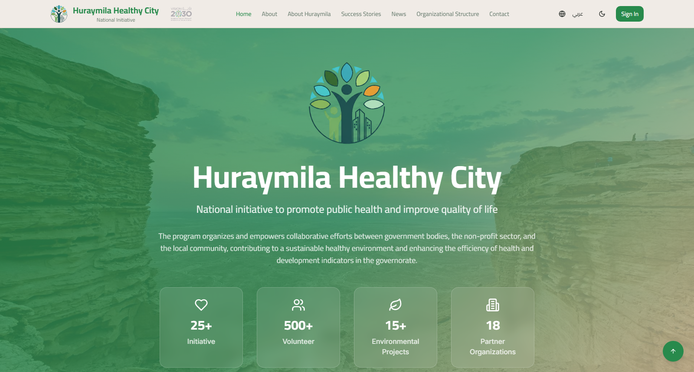                                        | **Vision** 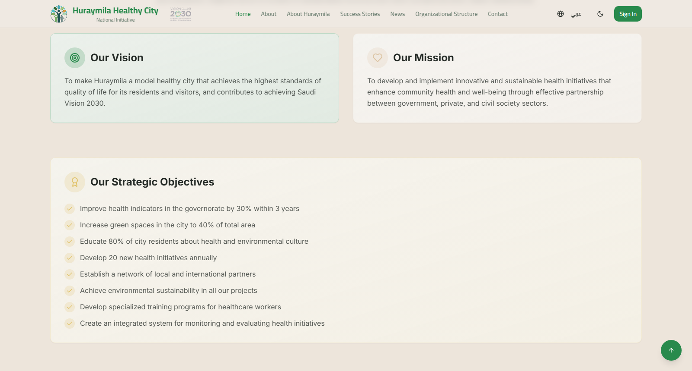                                        |
| **Timeline** 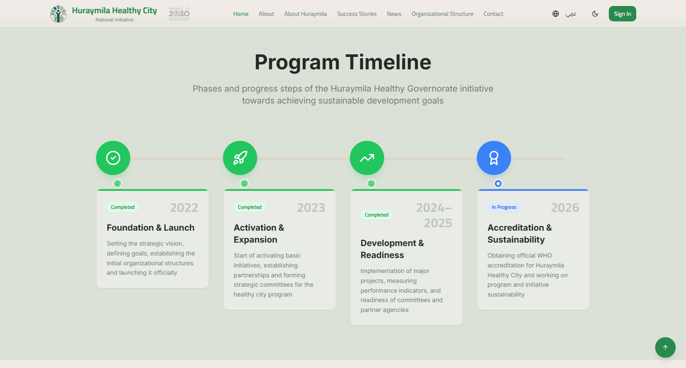                            | **Latest News** 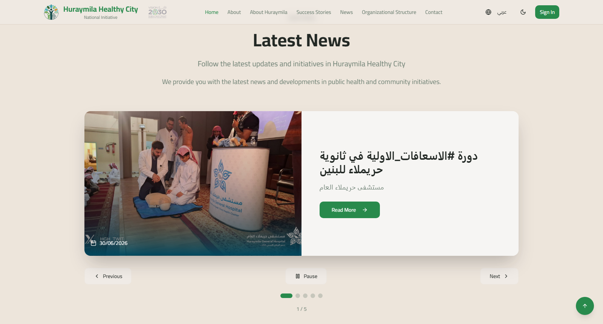                         |
| **Health Indicators** 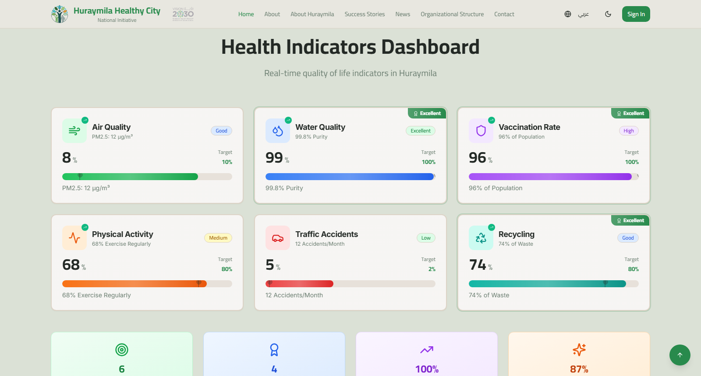 | **Standards Progress** 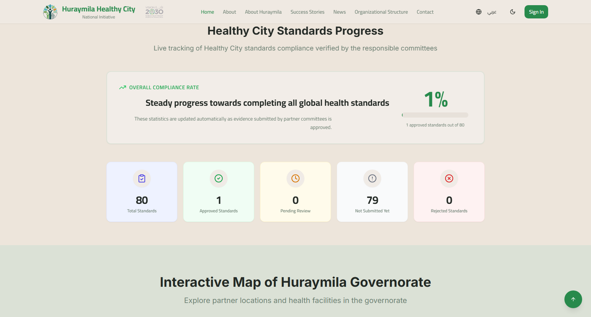    |
| **Community Network** 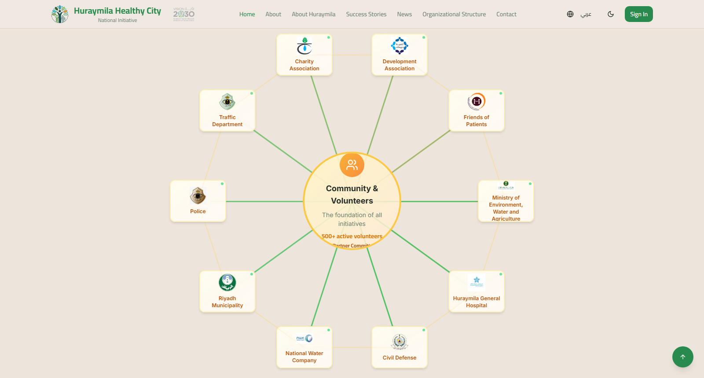 | **About** 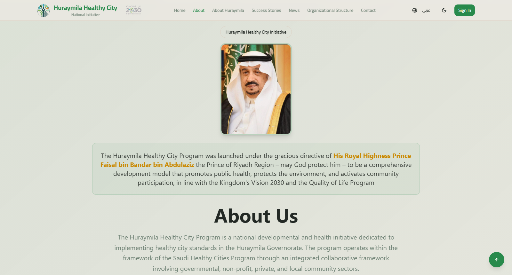                                           |
| **About Huraymila** 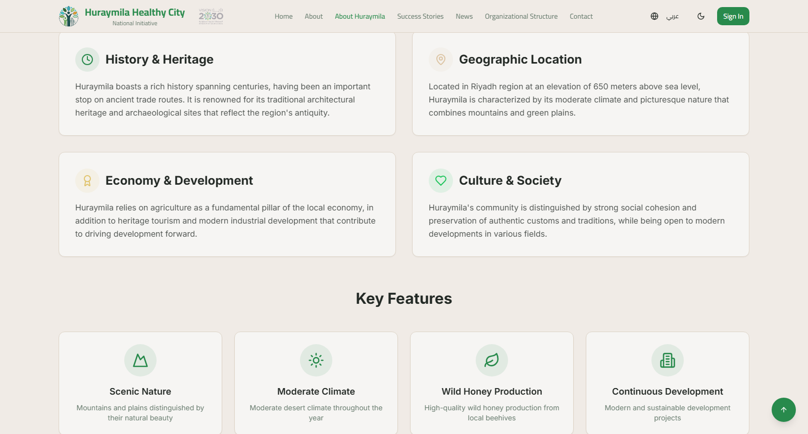       | **News** 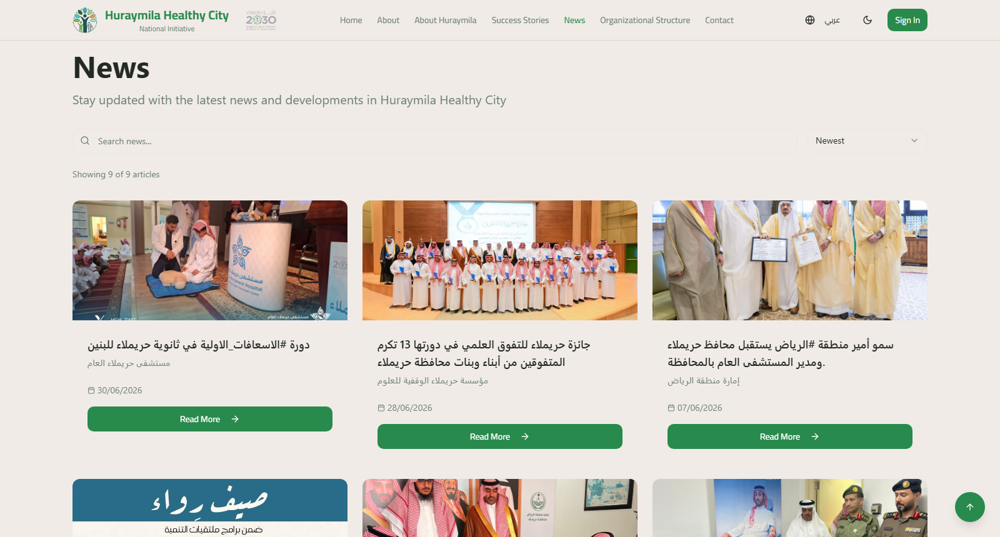                                              |
| **News Article** 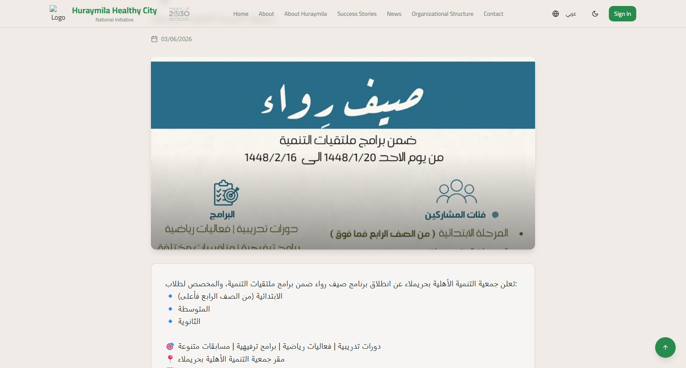                | **Organizational Structure** 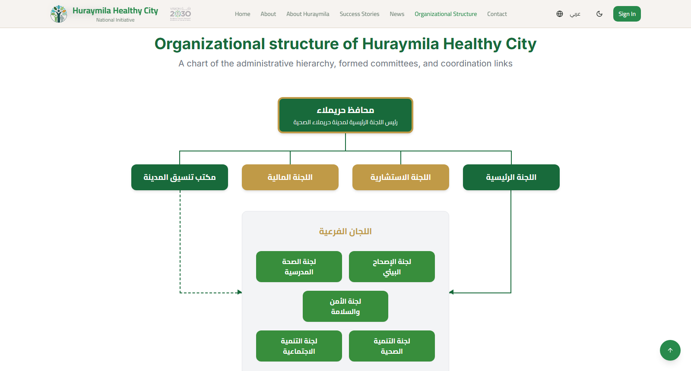 |
| **Login** 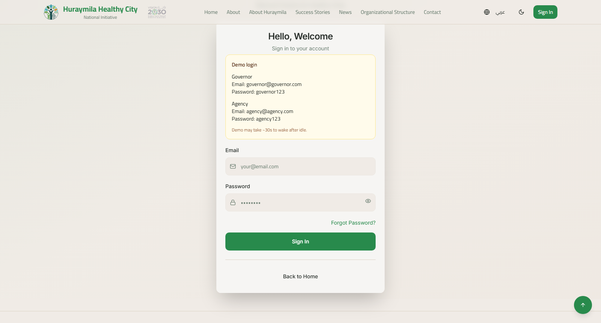                                     | **Governor Dashboard** 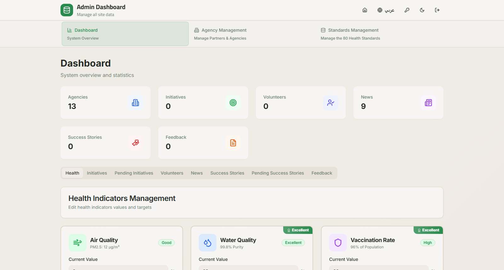    |
| **Agencies** 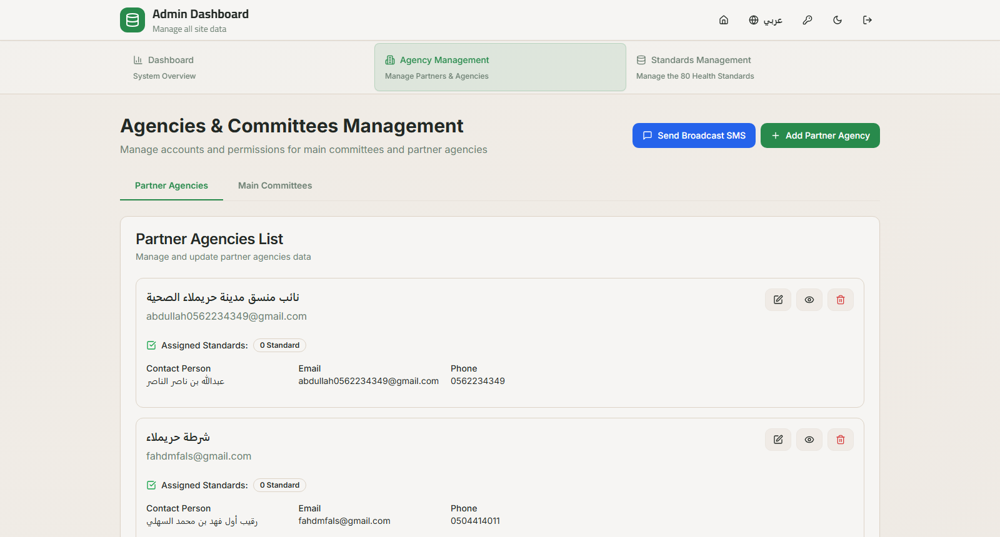                            | **Standards** 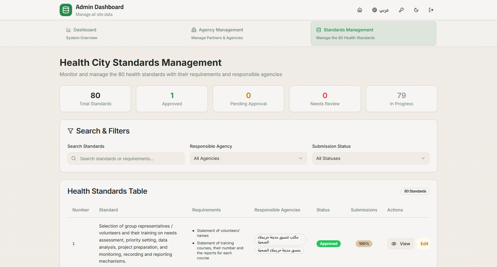                               |
| **Standard Evidence** 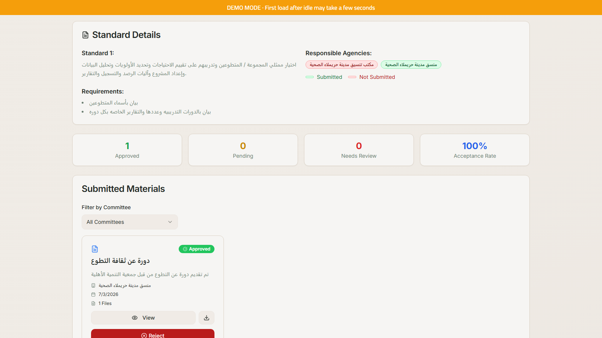 | **Agency Standards** 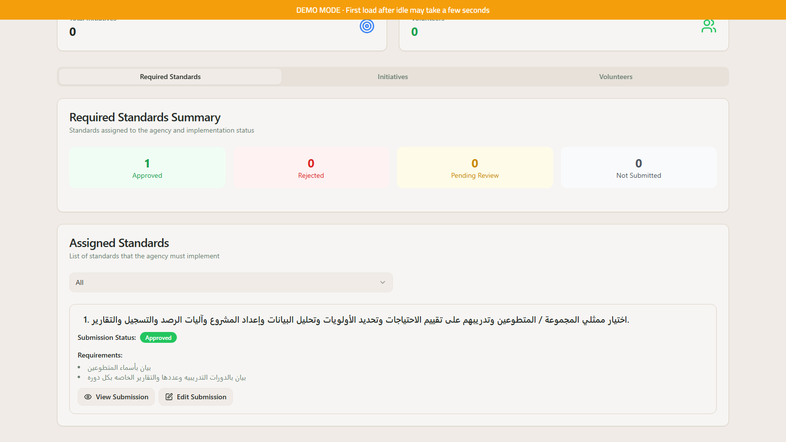          |
| **Mobile Home** 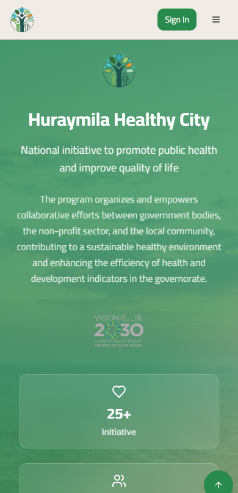                   |                                                                                                       |

---

## Live Demo 🚀

**[View Live Demo](https://huraymila-demo.vercel.app)**

| Role     | Email                                                 | Password    |
| -------- | ----------------------------------------------------- | ----------- |
| Governor | [governor@governor.com](mailto:governor@governor.com) | governor123 |
| Agency   | [agency@agency.com](mailto:agency@agency.com)         | agency123   |

---

## Author

👤 **Omar Mahmoud**
📧 [omrmhd54@gmail.com](mailto:omrmhd54@gmail.com)
💼 [LinkedIn](https://www.linkedin.com/in/omrmhd5/)
🌐 [Portfolio](https://omarmahmoud.dev/)
🔗 [GitHub](https://github.com/omrmhd5)
